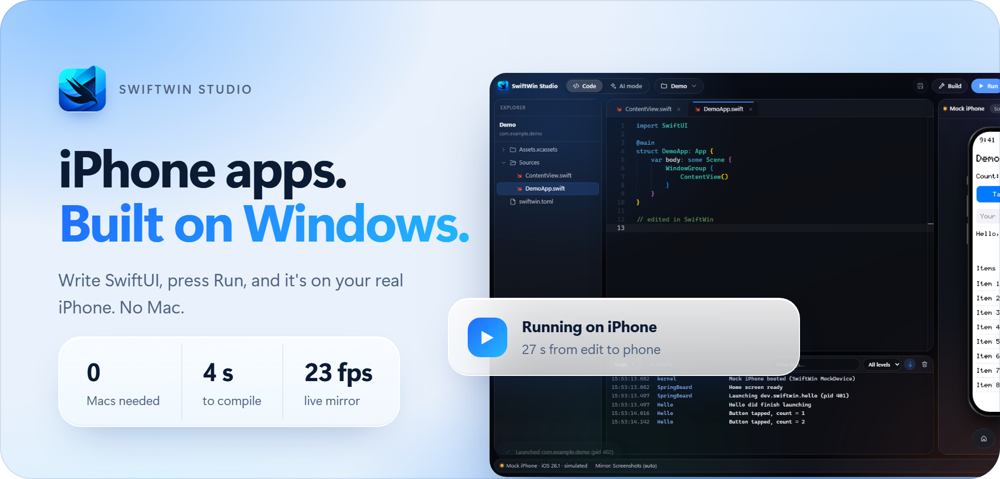
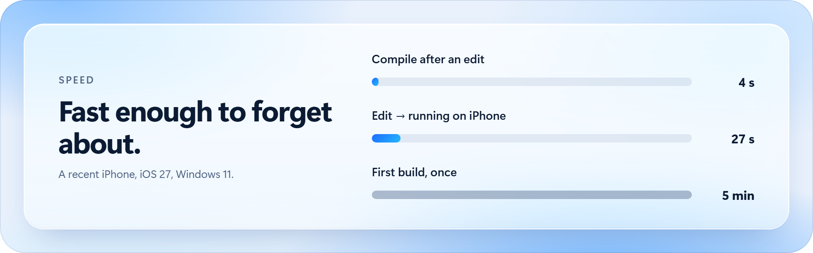
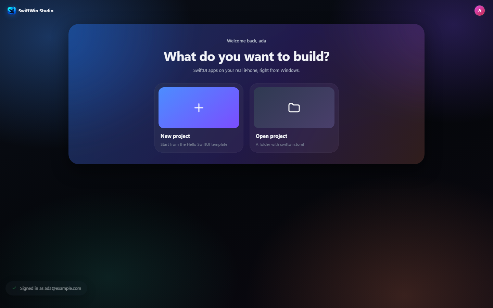
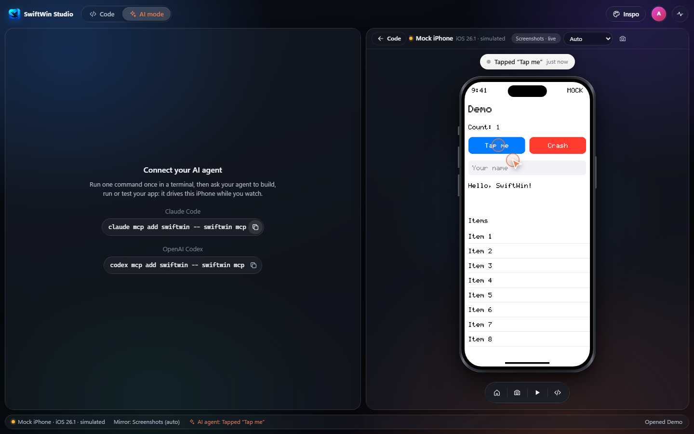
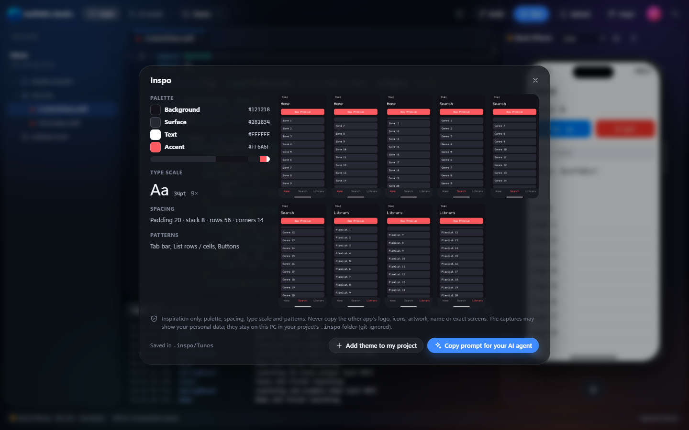
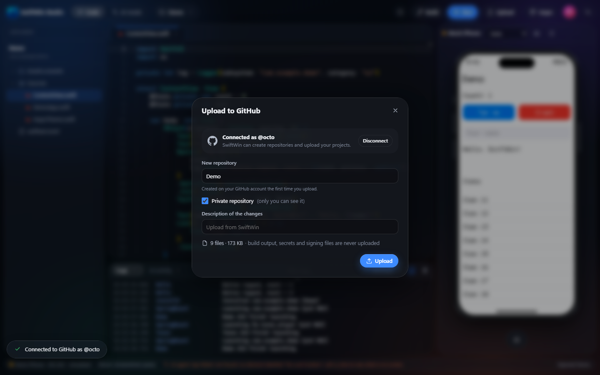

<p align="center">
  <a href="https://dadon-11.github.io/SwiftWin-Studio/">
    <picture>
      <source media="(prefers-color-scheme: dark)" srcset="docs/readme/hero-dark.png">
      
    </picture>
  </a>
</p>

<p align="center">
  <a href="https://github.com/Dadon-11/SwiftWin-Studio/releases/latest"></a>
  <a href="https://github.com/Dadon-11/SwiftWin-Studio/actions/workflows/ci.yml"></a>
  
  
  <a href="LICENSE"></a>
</p>

<p align="center">
  <b>SwiftWin: your iPhone, your Windows PC, and nothing else.</b><br>
  Build, sign, install and run SwiftUI apps on a real iPhone over USB, and let Claude Code or Codex drive it.<br>
  <a href="https://github.com/Dadon-11/SwiftWin-Studio/releases/latest"><b>Download</b></a> ·
  <a href="https://dadon-11.github.io/SwiftWin-Studio/">Website</a> ·
  <a href="docs/first-run.md">First run</a> ·
  <a href="#use-it-with-claude-code-or-codex">Claude Code &amp; Codex</a> ·
  <a href="CHANGELOG.md">Changelog</a>
</p>

---

https://github.com/user-attachments/assets/49e6149f-a1dc-4a06-be98-2d4219f87b8b

You know the problem. You want to make an iPhone app, you have a good Windows PC and an iPhone, and
every guide starts with "first, buy a Mac". SwiftWin skips that step: it compiles your SwiftUI app with
the open-source Swift toolchain, signs it with your Apple ID, installs it on the iPhone plugged into your
PC, and shows the phone live on your screen, where a click is a tap. Claude Code and Codex get the same
powers through SwiftWin's MCP server: they edit your app, run it on the phone, look at the screen, tap
through it and read the logs.

## Numbers

<p align="center">
  <a href="https://dadon-11.github.io/SwiftWin-Studio/#speed">
    <picture>
      <source media="(prefers-color-scheme: dark)" srcset="docs/readme/numbers-dark.png">
      
    </picture>
  </a>
</p>

<p align="center">
  <a href="https://github.com/sponsors/Dadon-11">
    <picture>
      <source media="(prefers-color-scheme: dark)" srcset="docs/readme/sponsor-dark.png">
      
    </picture>
  </a>
</p>

## Features

- **No Mac:** Swift on Windows targets `arm64-apple-ios`; the iOS SDK comes from Xcode, downloaded with
  your own Apple ID (never bundled).
- **Your real iPhone:** build, sign (free Apple ID or paid developer account), install and launch over
  USB in one click.
- **Live mirror you can use:** about 23 fps over USB; click to tap, drag to swipe, type to type.
  Optional AirPlay receiver.
- **SwiftWin Studio:** file tree, Monaco code editor, logs filtered to your app, crash reports.
- **AI mode:** connect Claude Code or OpenAI Codex, then watch every tap and swipe it makes on the phone.
- **AI agent integration (MCP, Claude Code and Codex):** `build`, `install_run`, `screenshot`, `ui_tree`, `tap`, `swipe`,
  `type`, `logs`, `launch_app`, and more. In the Claude desktop app the phone shows up beside the chat.
- **Inspo:** captures the screens of an app on your phone and turns them into a palette, type scale
  and spacing guide for your own app.
- **`swiftwin doctor`:** a PASS/FAIL checklist for USB driver, trust, Developer Mode, tunnel, signing
  and more, with the exact fix for each.
- **Cloud release:** TestFlight builds on a macOS GitHub Actions runner when you're ready to ship.
- **Optional account:** sign in with Google or GitHub only for the cloud features (TestFlight builds,
  uploading projects to GitHub). Everything else works without an account.

| Home | AI mode |
|---|---|
|  |  |
| **Inspo** | **Upload to GitHub** |
|  |  |

Screenshots use the built-in simulated iPhone (`--mock`).

## Requirements

- Windows 10 or 11, x64
- An iPhone (iOS 17 or newer) and a USB cable, with **Developer Mode** on
  (Settings → Privacy & Security → Developer Mode)
- An Apple ID (free works; apps then expire after 7 days and must be run again)
- Apple's USB service (iTunes), Python 3.11+, the **Swift 6.2.4** toolchain for Windows, **LLVM** and the
  iOS SDK: SwiftWin's **Set up this PC** installs all of them from their official sources (winget, and
  your own Apple sign-in for the SDK). Nothing of Apple's is bundled
- Optional: [Claude Code](https://claude.com/claude-code) or [OpenAI Codex](https://developers.openai.com/codex) for the AI features

## Install

1. Download `SwiftWin_<version>_x64-setup.exe` from the Releases page and run it. It installs for
   your user only (no admin rights). The installer isn't code-signed yet, so Windows may say
   "Windows protected your PC": click **More info → Run anyway**.
2. Open **SwiftWin** from the Start menu. Sign in, or choose **Continue without an account**: an account
   is needed only for cloud TestFlight builds and uploading to GitHub.
3. **Set up this PC** opens when something is missing: press **Set up everything**, accept Windows'
   permission prompts, and sign in with your Apple ID when asked (for the iOS SDK). Rerun it any time from
   the avatar menu, or `swiftwin setup` in a terminal.
4. Connect your iPhone and follow **[docs/first-run.md](docs/first-run.md)**. `swiftwin doctor` tells
   you what's missing.

No phone yet? Choose **Try with a simulated iPhone**, or run `swiftwin --mock demo`.

## Use it with Claude Code or Codex

```powershell
claude.cmd mcp add --scope user swiftwin -- "$env:LOCALAPPDATA\SwiftWin\bin\swiftwin.exe" mcp
```

For OpenAI Codex (its MCP servers are global, in `~\.codex\config.toml`):

```powershell
codex.cmd mcp add swiftwin -- "$env:LOCALAPPDATA\SwiftWin\bin\swiftwin.exe" mcp
```

Start a new Claude Code or Codex session and ask, for example: *"Use swiftwin: run my app, take a screenshot,
tap 'Tap me' three times and check the logs."* In the Claude desktop app, install the small
`swiftwin-phone` plugin so the live iPhone opens beside the chat by itself; see
[first-run.md, "Working in the Claude Code app"](docs/first-run.md#working-in-the-claude-code-app-with-a-phone-window).

Both agents ask before tool calls unless you allow them in their own settings; see
[docs/security.md](docs/security.md). AI mode in SwiftWin Studio shows these commands with copy buttons
and shows the agent's taps and swipes live on the phone.

## Build from source

You need Rust (stable, MSVC toolchain) and Node.js 20+.

```powershell
cargo test --workspace                         # all Rust tests, against the simulated iPhone
cargo build --release -p swiftwin-cli          # the `swiftwin` command line
cd app; npm ci; npm run tauri build            # the desktop app and its installer
```

The installer is `app\src-tauri\target\release\bundle\nsis\SwiftWin_<version>_x64-setup.exe`. Install
it from a normal PowerShell or the Claude desktop app's Terminal panel, not from a process the Claude
app started itself (docs/open-questions.md, 23). The browser UI test is described at the top of
`app/tests/ui-mock.mjs`. Releases and signed updates: [docs/releasing.md](docs/releasing.md).

Try things without a phone: every command accepts `--mock` (or `SWIFTWIN_MOCK=1`):

```powershell
cargo run -p swiftwin-cli -- --mock demo
cargo run -p swiftwin-cli -- --mock doctor
```

### Commands

| Area | Commands |
|---|---|
| Device | `devices`, `info`, `pair`, `apps`, `install`, `uninstall`, `launch`, `terminate`, `screenshot`, `logs [-f]`, `crashes` |
| Control | `tap [x y \| --label]`, `swipe`, `type`, `button`, `home`, `ui-tree`, `wda status\|start\|stop\|prepare\|install\|serve` |
| Build | `new`, `build`, `run`, `sign`, `signing setup\|status`, `sdk list\|import\|download` |
| Mirroring | `mirror [--airplay] [--mode auto\|usb\|video]` |
| Claude | `mcp` (stdio MCP server), `phone` (the phone-only window) |
| Account | `login`, `logout`, `whoami`, `upload` |
| Release | `release setup`, `release [--dry-run]` (TestFlight via a macOS GitHub Actions runner) |
| Setup | `doctor [--fix]`, `setup`, `ui` (desktop UI in a browser, for development) |

### Layout

```
crates/
  swiftwin-core       shared types, errors, paths, config
  swiftwin-device     Device trait, MockDevice, RealDevice (usbmuxd + lockdown + pymobiledevice3)
  swiftwin-control    WebDriverAgent client and lifecycle, Phone facade, fake WDA server
  swiftwin-sdk        Xcode.xip → iOS SDK (XAR/pbzx/cpio), Swift SDK bundle, Xcode download
  swiftwin-builder    swiftwin.toml projects, swiftc for arm64-apple-ios, asset catalogs, .app/.ipa
  swiftwin-signer     certificates, profiles, entitlements, code signing, Credential Manager
  swiftwin-workflow   build → sign → install → launch, WDA preparation
  swiftwin-mirror     USB video (WebDriverAgent MJPEG) or AirPlay, falling back to screenshots
  swiftwin-mcp        MCP server for Claude Code and Codex
  swiftwin-app-core   desktop app backend (shared by Tauri and `swiftwin ui`)
  swiftwin-account    accounts (Supabase Auth), GitHub upload
  swiftwin-inspo      Inspo captures and style guides
  swiftwin-release    cloud TestFlight builds
  swiftwin-doctor     PASS/FAIL first-run checks
cli/                  `swiftwin` binary
app/                  Tauri desktop app (Vite + Monaco)
claude-plugin/        the swiftwin-phone plugin for the Claude desktop app
docs/                 guides and design notes
```

## Status: iPhone apps only, for now

SwiftWin is early. Today it builds **iPhone apps only** (SwiftUI, iOS 17 and newer):

- **Not supported yet:** iPad layouts (apps are built for iPhone only, so they don't install as iPad
  apps), Mac apps (macOS / Mac Catalyst), Apple Watch, Apple TV, Vision Pro, widgets and other app
  extensions.
- **Not optimized for every iPhone yet:** it has been tested end to end on one recent iPhone (iOS 27,
  free Apple ID). Other models, screen sizes and form factors (for example a
  foldable iPhone) aren't tested: your app may build and run, but check its layout there yourself.

Paths that have never run on a real phone
or Apple account are listed in [docs/untested.md](docs/untested.md); help testing on other iPhones is
welcome ([docs/testing-checklist.md](docs/testing-checklist.md)).

## Privacy and security

- [PRIVACY.md](PRIVACY.md): what SwiftWin stores if you make an account (email and name) and what stays on your
  PC (everything else). No analytics.
- [TERMS.md](TERMS.md): terms of use.
- [SECURITY.md](SECURITY.md) and [docs/security.md](docs/security.md): the threat model, how tokens and
  the local API are protected, and how to report a vulnerability.

## Docs

- [docs/first-run.md](docs/first-run.md): connecting your iPhone the first time
- [docs/dependencies.md](docs/dependencies.md): external tools and their licenses
- [docs/accounts-setup.md](docs/accounts-setup.md): running your own sign-in service
- [docs/releasing.md](docs/releasing.md): releases, signed updates, code signing
- [docs/progress.md](docs/progress.md), [docs/open-questions.md](docs/open-questions.md): what was tried, what's unverified
- [CONTRIBUTING.md](CONTRIBUTING.md): how to contribute

## Code signing policy

Releases are built from this repository. We have applied to the [SignPath Foundation](https://signpath.org)
for free code signing for open-source projects; once accepted, Windows installers are signed with free code
signing provided by [SignPath.io](https://signpath.io), certificate by SignPath Foundation. Until then the
installer is not code-signed: Windows may show "Windows protected your PC" (More info → Run anyway). Each
release lists the installer's SHA-256 so you can check your download, and
`winget install SwiftWin.SwiftWin` installs it without that warning once the package is published.

- Committer, reviewer and release approver: Yoav Dadon ([@Dadon-11](https://github.com/Dadon-11)). Changes
  written with AI assistance (Claude) are reviewed and approved by the maintainer before release.
- Privacy: SwiftWin sends no analytics; see [PRIVACY.md](PRIVACY.md) for the optional account.

## Author

Made by Yoav Dadon ([@Dadon-11](https://github.com/Dadon-11)), with
[Claude](https://claude.com/claude-code) (Anthropic's AI) as co-developer: most of the code, tests and docs
were written with Claude Code. Contact: swiftwin-support@googlegroups.com.

## License

[MIT](LICENSE). Third-party code and tools keep their own licenses: see
[THIRD-PARTY-NOTICES.md](THIRD-PARTY-NOTICES.md). SwiftWin is not affiliated with Apple. Apple's iOS SDK
is downloaded by each user from Apple and is never redistributed.
