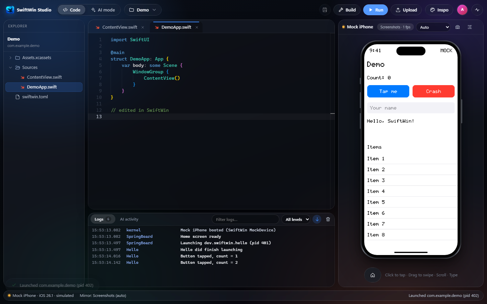

# SwiftWin Studio

**Build, run and test SwiftUI iPhone apps on Windows, on your real iPhone, with no Mac.**

SwiftWin is a free, open-source Windows app. It compiles your SwiftUI app, signs it with your Apple ID,
installs it on the iPhone connected over USB, and shows the phone live on your screen, where a click is a
tap. Claude Code and OpenAI Codex can use it too: they build, run, look at and tap through your app on
the phone.

## Get it

- [Download for Windows 10/11](https://github.com/Dadon-11/SwiftWin-Studio/releases/latest), or in
  PowerShell: `winget install SwiftWin.SwiftWin` (once the package is published)
- [Source code on GitHub](https://github.com/Dadon-11/SwiftWin-Studio) (MIT license)
- [First run: connecting your iPhone](https://github.com/Dadon-11/SwiftWin-Studio/blob/main/docs/first-run.md)

iPhone apps only for now: iPad and Mac apps aren't supported yet.

## Legal

- [Privacy Policy](privacy/)
- [Terms of Use](terms/)

Contact: swiftwin-support@googlegroups.com
